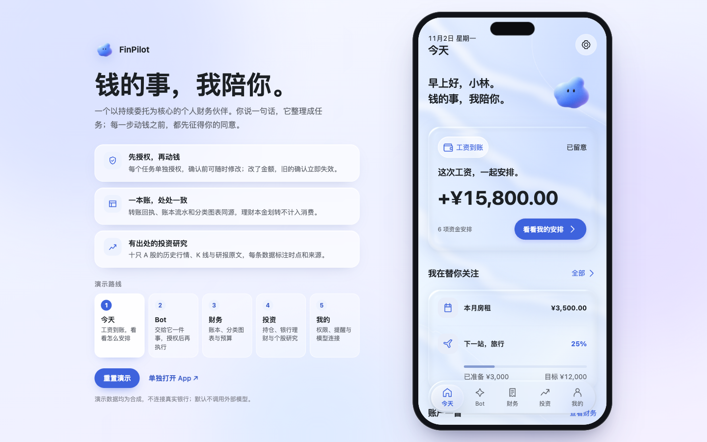
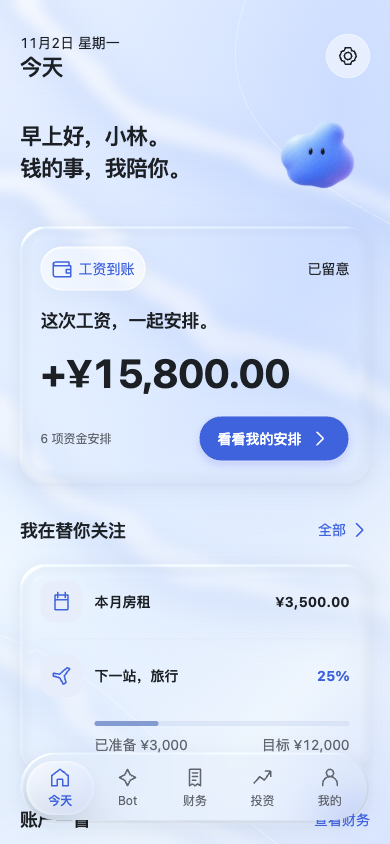
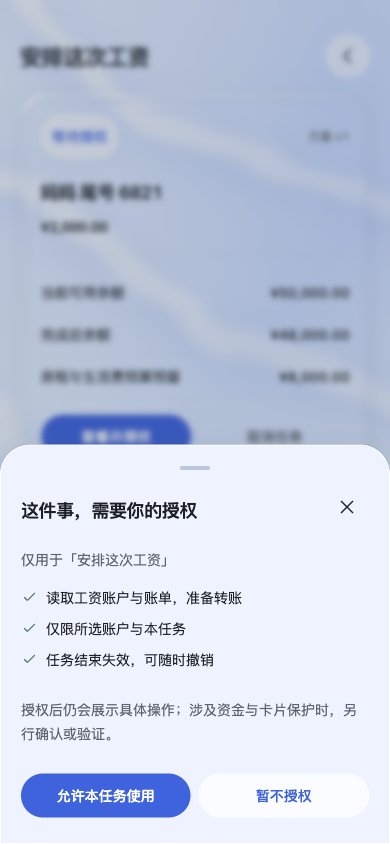
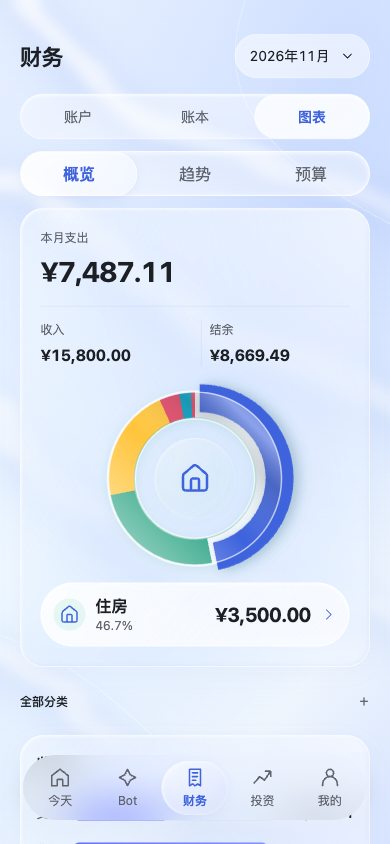
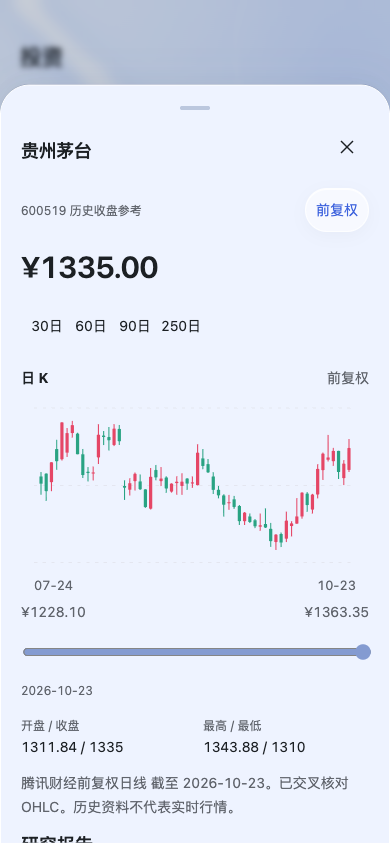

<p align="center"></p>
<h1 align="center">FinPilot</h1>
<p align="center"><b>钱的事，我陪你。</b><br>一个以持续委托为核心的个人财务伙伴</p>



## 它做什么

工资到账要分配，房租要预留，会员悄悄涨价，账上冒出一笔陌生交易。这些事交给 FinPilot 盯着：你用一句话把事情交给 Bot，它整理成一张任务卡，写清楚动哪笔钱、动多少、动完还剩多少。真正执行之前，每一步都要你点头。

## 亮点

**先授权，再动钱。** 任务第一次操作前单独申请权限，范围只限这个任务和所选账户，任务结束即失效。确认之前可以随时改金额；一旦改了，之前的确认立即作废，必须按新方案重新核对。

**结果不明，绝不重复扣款。** 提交后如果暂时拿不到回执，任务进入「正在核实」，只能核实、不能重新发起；核实成功才生成回执并记入账本。

**一本账，处处一致。** 转账回执、账本流水、分类环图和预算出自同一份数据；理财本金划转不计入消费。

**有出处的投资研究。** 十只 A 股的历史日 K、开收盘与研报原文，每条数据标注截止日期和来源。

**液态玻璃界面。** 所有页面共享一个 WebGL context 渲染折射材质，文字和控件仍是原生 DOM；WebGL 不可用时自动降级为可读的半透明表面。

<table>
  <tr>
    <td align="center"><br>今天：工资到账</td>
    <td align="center"><br>Bot：按任务授权</td>
    <td align="center"><br>财务：分类图表</td>
    <td align="center"><br>投资：个股研究</td>
  </tr>
</table>

## 快速开始

需要 Python 3.12，只用标准库，不用装依赖，也不用构建前端。

```sh
python server.py
```

打开 <http://127.0.0.1:65281/>。宽屏打开是展示页：左侧是介绍和可点击的演示路线，右侧手机外框里是完整 App；手机或窄窗口打开直接进入 App。首次启动会自动写入合成的演示持仓。

更多选项（换端口、接入大模型、关闭材质）见 [RUNNING.md](RUNNING.md)。

## 三分钟演示

1. **今天**：工资 ¥15,800 到账，点「看看我的安排」。
2. **Bot**：任务卡列出给妈妈转 ¥2,000 和转完后的余额。点「查看并授权」看清权限范围，允许后「修改金额」改成 2500，旧确认随即失效；重新核对、验证身份后提交。
3. **核实**：提交后先进入「正在核实」，点「核实这笔结果」拿到回执，处理记录里能看到每一步。
4. **财务**：账本里多了这笔转账，图表和预算同步更新。
5. **投资**：看合成持仓的盈亏，打开个股研究的 K 线和研报。

演示前点展示页上的「重置演示」，可以回到工资刚到账的状态。也可以在 Bot 里试试「核查陌生交易」「看看订阅扣费」，或在「我的 → 演示事件」里触发更多场景。

## 实现

| 部分 | 做法 |
| --- | --- |
| 服务端 | `server.py`，Python 标准库 HTTP 服务，只监听 127.0.0.1；持仓存 SQLite（`.runtime/`，不进版本库） |
| 前端 | 原生 ES modules，无框架、无打包；任务、账本和对话状态保存在浏览器本地 |
| 任务引擎 | `web/engine.mjs`：授权 → 核对 → 验证 → 执行 → 核实的状态机，金额修改即令旧确认失效，提交后幂等对账 |
| 材质 | `web/material/`：共享 WebGL 折射渲染，按帧耗时自动降档，失败时降级 |
| 大模型（可选） | 默认关闭，Bot 用本地规则回复；开启后经本机代理调用 DeepSeek，密钥只存在服务进程内存里 |

## 测试

```sh
node --test tests/*.test.mjs
python -m unittest discover -s tests -p "test_*.py"
```

覆盖权限与修改失效、幂等对账、流水与图表同源、记账采集的预览/确认/撤销、模型代理的错误/取消/密钥脱敏，以及材质渲染的调度边界。测试只用合成数据和 mock，不访问真实模型或银行。

## 数据与来源

- 所有金额、账户和银行动作都是演示数据，项目不连接任何真实银行，模型也没有直接动用资金的权限。
- 个股行情与研报为历史资料，保留截止日期与来源，仅作研究展示，不代表实时行情或投资建议。
- 公司标识商标归各自权利人所有；配色取自 [Radix Colors](https://github.com/radix-ui/colors)（MIT），第三方说明见 [web/baseline/motion/THIRD_PARTY_NOTICES.md](web/baseline/motion/THIRD_PARTY_NOTICES.md)。
